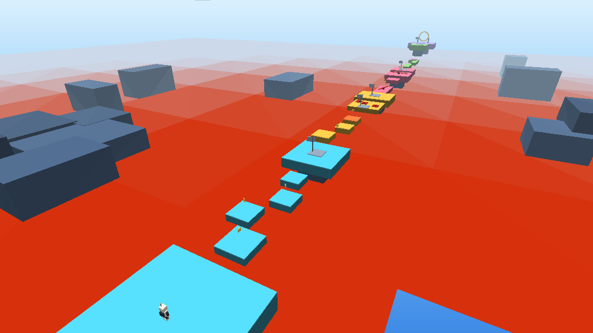

# 🎮 Skyhop — Parkour Langit

**▶ Main langsung: https://aruminajwa.github.io/skyhop/**

Game parkour 3D yang berjalan langsung di browser — **tanpa install, tanpa internet, tanpa library**. Semua 3D-nya ditulis manual pakai WebGL murni (±62 KB kode), termasuk karakter, level, dan suaranya.



## Cara main

1. Buka folder ini.
2. **Klik dua kali `index.html`** (Chrome / Edge / Firefox terbaru).
3. Tekan **MAIN** atau **Enter**.

Tidak perlu server, tidak perlu `npm install`. Kalau mau di-host, taruh saja folder ini di layanan statis apa pun (GitHub Pages, Netlify, dsb).

## Kontrol

| Aksi | Keyboard / Mouse | HP |
| --- | --- | --- |
| Jalan | `W` `A` `S` `D` / panah | joystick kiri |
| Lompat | `Space` (tahan = lompat lebih tinggi) | tombol JUMP |
| Lari cepat | `Shift` | — |
| Putar kamera | gerak mouse (klik dulu untuk lock) atau drag | geser layar |
| Zoom | scroll | — |
| Kembali ke checkpoint | `R` | — |
| On/off suara | `M` | ikon 🔊 |
| Mulai ulang dari awal | tombol ⟲ | tombol ⟲ |

## Isi game

5 zona, 21 platform, ±200 unit lintasan, di atas lautan lava:

1. **Pemanasan** — lompatan dasar antar pulau.
2. **Pijakan Hilang** — platform bergerak + 3 platform yang memudar (berkedip merah sebelum hilang) + ubin merah mematikan.
3. **Pisau Putar** — jembatan sempit dengan palang berputar yang harus dilompati, lalu platform yang bergerak naik-turun.
4. **Lompatan Tinggi** — balok sempit dan trampolin yang melempar ke platform atas.
5. **Finish** — gerbang cincin emas.

Detail lain:

- **Karakter orisinal "Kurir Langit"**: robot kecil berhelm dengan visor menyala, antena, dan jetpack — dibuat dari kotak, tanpa aset pihak mana pun.
- **5 checkpoint** (bendera berubah hijau kalau aktif) — mati tidak mengulang dari awal.
- **8 bintang** untuk dikoleksi.
- Timer, jumlah kematian, progress bar, dan **rekor terbaik** tersimpan di `localStorage`.
- Efek: partikel lompat/mati/checkpoint, konfeti saat finish, bayangan pemain, kabut, langit gradien.
- Suara disintesis langsung pakai Web Audio (tanpa file audio).
- Kontrol sentuh otomatis muncul di HP.

## Struktur file

```
skyhop/
├─ index.html          # HUD, menu, styling (semua UI)
├─ game.js             # renderer WebGL + fisika + level + audio
└─ tools/              # alat bantu pengembangan (tidak dipakai saat main)
   ├─ test.js          # tes otomatis fisika & gameplay di Node
   ├─ mock.js          # DOM + WebGL tiruan untuk tes
   ├─ dump-scene.js    # ekspor geometri scene ke JSON
   └─ render-preview.py# rasterizer kecil untuk cek visual
```

## Cara mengubah game

Semua ada di `game.js`:

- **Level** — fungsi `buildLevel()`. Tiap baris seperti:
  `platform(x, tinggiPermukaan, z, lebar, panjang, { color, h })`.
  Bantuannya: `checkpoint()`, `coin()`, `killTile()`, `bouncePad()`, `spinner()`, `mover()`, `blink()`.
- **Rasa gerak** — objek `CFG` di atas: `gravity`, `jump`, `speed`, `sprint`, `camDist`.
- **Warna** — objek `PAL` (zona 1–5, lava, checkpoint, dll).
- **Karakter** — objek `playerParts` (bentuk tiap bagian) dan `updatePlayerVisuals()` (posisi & animasinya).
- **Tingkat kesulitan** — angka `amp`/`speed` pada `mover()` dan `spinner()`, atau `period`/`onTime` pada `blink()`.

Setelah mengubah level, jalankan tes:

```bash
node tools/test.js
```

## Catatan pengembangan

- Renderer: WebGL 1, satu shader untuk semua kotak statis (1 draw call), shader billboard untuk partikel, shader flat untuk lava & bayangan.
- Fisika: AABB, langkah tetap 120 Hz, coyote time, jump buffer, dan platform bergerak yang ikut membawa pemain.
- Tidak ada dependency eksternal — sengaja, supaya bisa dibuka dari `file://` tanpa server.

## Update & deploy

Situs ini di-host di GitHub Pages dari branch `main` (root). Setelah mengubah file:

```bash
git add .
git commit -m "update level"
git push
```

GitHub akan build ulang otomatis dalam ±30 detik, lalu perubahan langsung tampil di
https://aruminajwa.github.io/skyhop/

